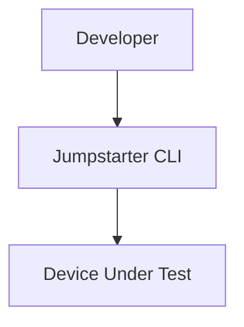
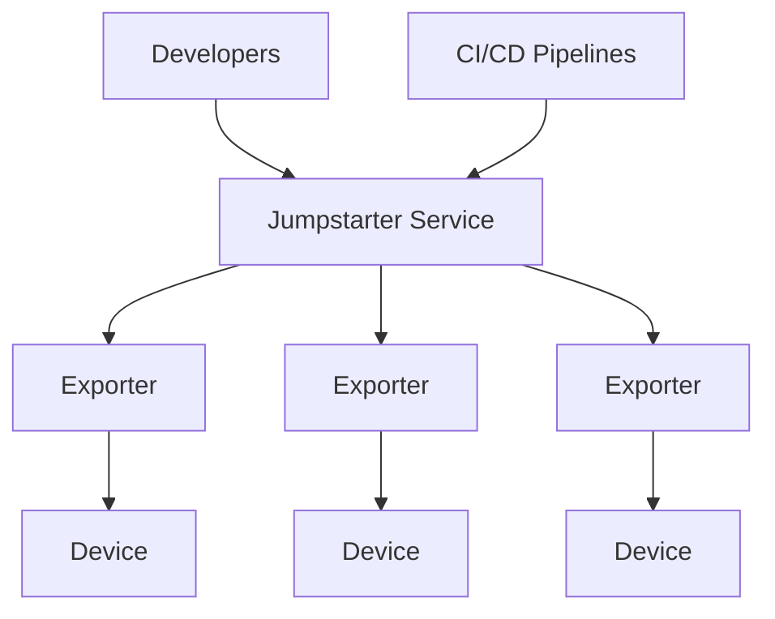

# How Can I Use This?

  <h3 class="text-xl font-bold mb-4 text-blue-400">Local</h3>

  <h3 class="text-xl font-bold mb-4 text-green-400">Distributed</h3>

---
layout: default
---

# Example Use Cases

  <h3 class="font-bold mb-2">Local Dev</h3>
  
Developer + CLI + QEMU

  <h3 class="font-bold mb-2">Remote Dev</h3>
  
Developer + Service + Exporter + DUT

  <h3 class="font-bold mb-2">Remote CI</h3>
  
CI Pipeline + Service + Exporter + DUT

  <h3 class="font-bold mb-2">Local CI</h3>
  
CI Pipeline + Runner + DUT

  
  
  

