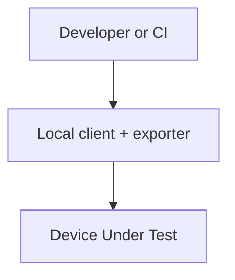
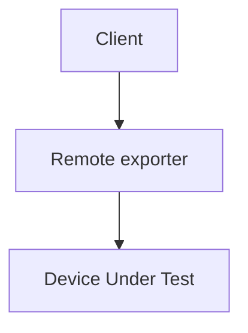
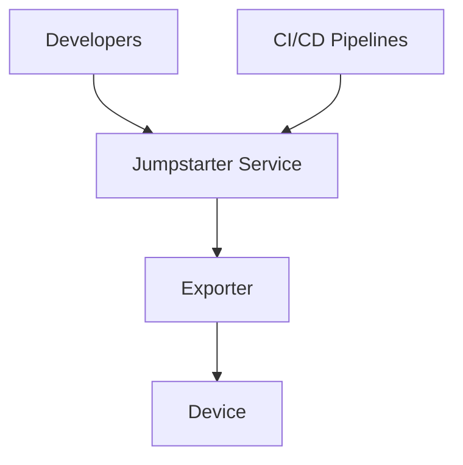
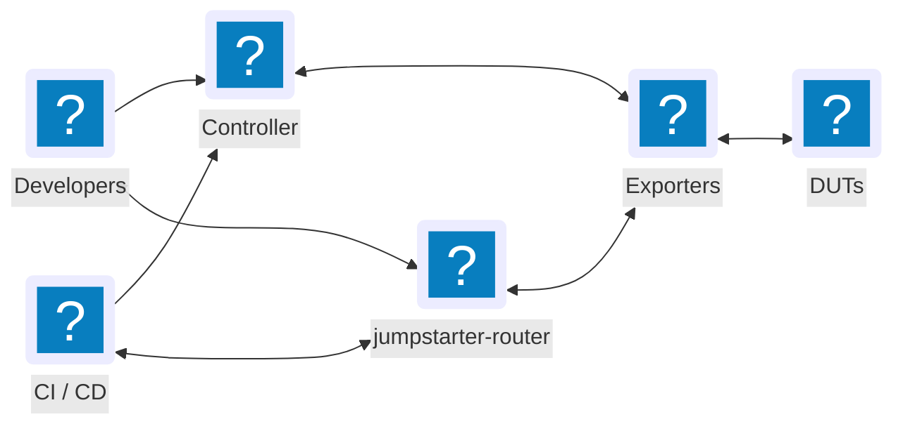
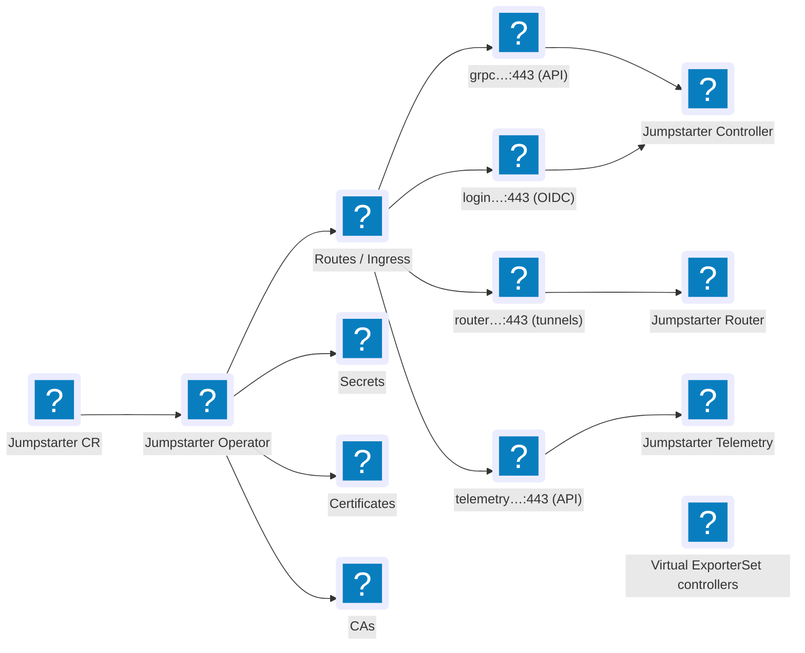
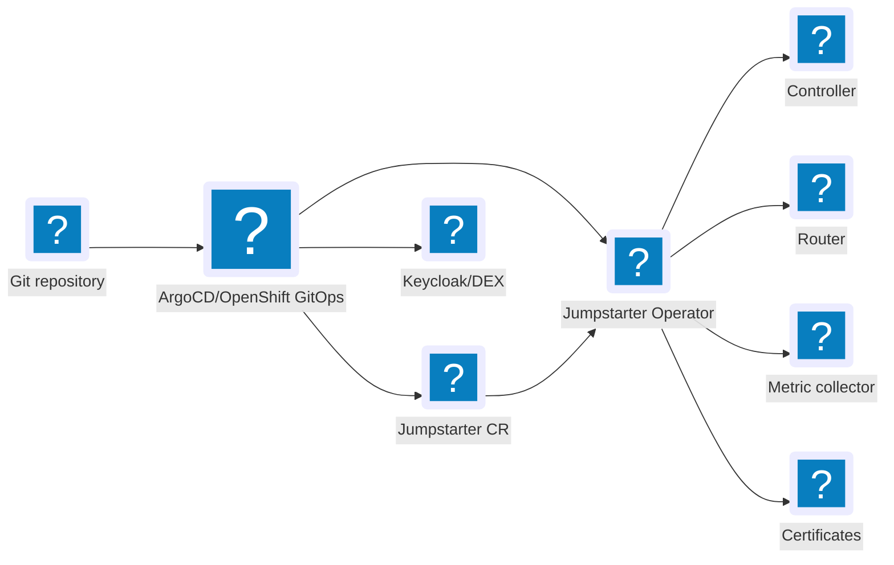
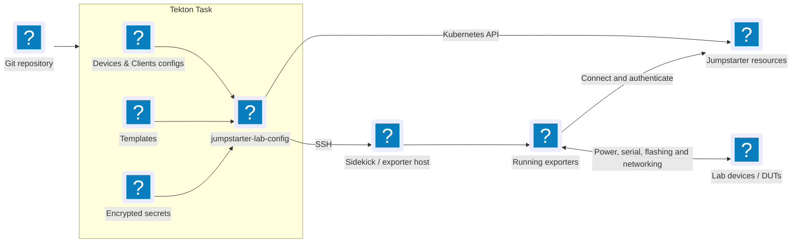
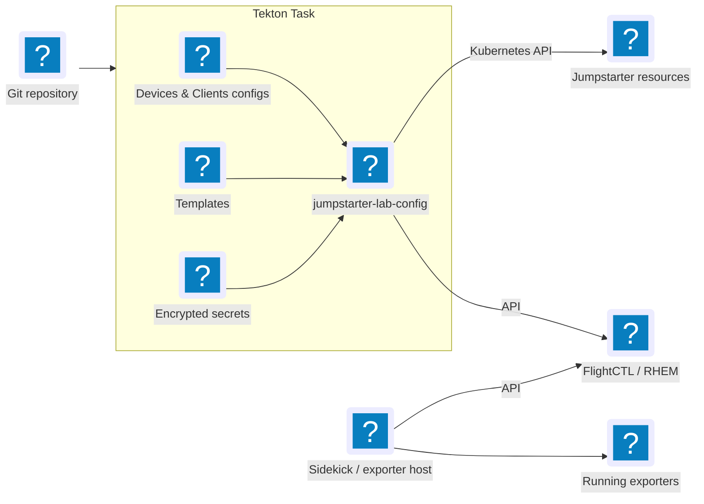

<div class="absolute inset-0 bg-[#f0f0f0]" />

<div class="absolute top-[26%] left-14 z-10">
  
</div>

<div class="absolute bottom-0 left-0 right-0 h-[42%] bg-[#ffc107] z-10">
  <div class="px-14 pt-6">
    <p class="text-4xl font-semibold text-black leading-tight tracking-tight">Deployment Options</p>
    <p class="text-lg text-black mt-2">From a developer's bench to a shared device lab</p>
    <p class="text-lg text-black mt-2" style="font-family: sans-serif;">Miguel Angel Ajo Pelayo <a class="underline" href="mailto:majopela@redhat.com">majopela@redhat.com</a></p>
  </div>
</div>

---
layout: default
---

# Agenda


<div class="grid grid-cols-2 gap-x-12 gap-y-3 mt-10 text-base">

<div class="flex gap-3 items-start">
  <span class="font-bold text-[#ffc107] shrink-0">01</span>
  <div>
    <p class="font-semibold">Operation modes</p>
    <p class="text-sm opacity-70">Local, direct, and distributed</p>
  </div>
</div>

<div class="flex gap-3 items-start">
  <span class="font-bold text-[#ffc107] shrink-0">02</span>
  <div>
    <p class="font-semibold">The shared lab</p>
    <p class="text-sm opacity-70">Three jobs and a peek at RHIVOS</p>
  </div>
</div>

<div class="flex gap-3 items-start">
  <span class="font-bold text-[#ffc107] shrink-0">03</span>
  <div>
    <p class="font-semibold">Running the service</p>
    <p class="text-sm opacity-70">Options, operator install, networking, security</p>
  </div>
</div>

<div class="flex gap-3 items-start">
  <span class="font-bold text-[#ffc107] shrink-0">04</span>
  <div>
    <p class="font-semibold">GitOps with ArgoCD</p>
    <p class="text-sm opacity-70">Managing Jumpstarter via the operator</p>
  </div>
</div>

<div class="flex gap-3 items-start">
  <span class="font-bold text-[#ffc107] shrink-0">05</span>
  <div>
    <p class="font-semibold">Exporter hosts</p>
    <p class="text-sm opacity-70">Sidekick, lab-config, FlightCTL / RHEM</p>
  </div>
</div>

<div class="flex gap-3 items-start">
  <span class="font-bold text-[#ffc107] shrink-0">06</span>
  <div>
    <p class="font-semibold">Installing the client</p>
    <p class="text-sm opacity-70">pip and the one-liner installer</p>
  </div>
</div>

<div class="flex gap-3 items-start">
  <span class="font-bold text-[#ffc107] shrink-0">07</span>
  <div>
    <p class="font-semibold">Community</p>
    <p class="text-sm opacity-70">Links and next steps</p>
  </div>
</div>

</div>

---
layout: default
---

# Three Ways to Run Jumpstarter

<div class="grid grid-cols-3 gap-8 mt-8">

<div>
  <h3 class="text-xl font-bold mb-4 text-blue-400">Local</h3>



  <p class="text-sm opacity-75 mt-3">Client and exporter on the same host. No service, no cluster.</p>
</div>

<div>
  <h3 class="text-xl font-bold mb-4 text-green-400">Direct</h3>



  <p class="text-sm opacity-75 mt-3">Client connects to the exporter directly over TCP. No controller.</p>
</div>

<div class="relative">
  <h3 class="text-xl font-bold mb-4 text-purple-400">Distributed</h3>

  <div v-click class="absolute -top-1 right-0 flex items-center gap-1 bg-[#ffc107] text-black text-xs font-semibold px-2 py-1 rounded shadow">
    ← our focus
  </div>



  <p class="text-sm opacity-75 mt-3">Full service on Kubernetes. Leases, access control, multi-user.</p>
</div>

</div>

<div class="absolute bottom-4 left-14 text-xs opacity-60">Source: <a href="https://jumpstarter.dev/main/getting-started/guides/setup/index.html">Setup guides</a></div>

---
layout: two-cols-header
layoutClass: gap-x-8
class: text-sm
---

# Jumpstarter Distributed mode

Shared lab on a Kubernetes/OpenShift cluster: a controller coordinates access; a router tunnels traffic to exporters.

::left::



::right::

<div class="flex flex-col gap-2 self-start! mt-0">

<div class="border-l-3 border-[#ffc107] pl-3">
  <div class="font-semibold leading-tight">Leases (exclusive, shareable)</div>
  <div class="opacity-75 text-xs leading-tight">One owner per lease; optionally share for pairing, observe, or CI handoff</div>
</div>

<div class="border-l-3 border-[#ffc107] pl-3">
  <div class="font-semibold leading-tight">Label selectors</div>
  <div class="opacity-75 text-xs leading-tight">Pick hardware based on labels(<code>board=foo</code>)</div>
</div>

<div class="border-l-3 border-[#ffc107] pl-3">
  <div class="font-semibold leading-tight">Auth and access control</div>
  <div class="opacity-75 text-xs leading-tight">OIDC for clients/exporters, access policies</div>
</div>

<div class="border-l-3 border-[#ffc107] pl-3">
  <div class="font-semibold leading-tight">Reachability without public IPs</div>
  <div class="opacity-75 text-xs leading-tight">gRPC router tunnels through NAT and firewalls</div>
</div>

<div class="border-l-3 border-[#ffc107] pl-3">
  <div class="font-semibold leading-tight">Multi-user and CI-ready</div>
  <div class="opacity-75 text-xs leading-tight">Shared lab for developers and pipelines (Tekton, Jenkins, Gitlab, etc…)</div>
</div>

</div>

::bottom::

<p class="text-xs opacity-60">Sources: <a href="https://jumpstarter.dev/main/introduction/service.html">Service</a> · <a href="https://jumpstarter.dev/main/getting-started/guides/setup/distributed-mode.html">Distributed mode</a></p>

---
layout: default
---

# Three jobs to run a shared lab

Distributed mode needs working clients, a **service**, the **exporter fleet**, and **monitoring**.

<div class="grid grid-cols-3 gap-8 mt-10 text-sm">

<div class="border-l-3 border-[#ffc107] pl-4">
  <h3 class="font-bold text-lg mb-2">1. Deploy the service</h3>
  <p class="opacity-80 mb-3">Controller, router and metrics/tracing a cluster: leases, auth, routing, and APIs.</p>
  <ul class="opacity-75 space-y-1 text-xs">
    <li>Where to run it: on a <b>k8s/OpenShift cluster</b></li>
    <li>How: Using the <b>jumpstarter-operator</b></li>
    <li><b>GitOps</b> with ArgoCD/OpenShift GitOps is possible</li>
  </ul>
  <p class="mt-4 text-xs font-semibold text-[#b8860b]">Next →</p>
</div>

<div class="border-l-3 border-[#ffc107] pl-4">
  <h3 class="font-bold text-lg mb-2">2. Manage exporters</h3>
  <p class="opacity-80 mb-3">Many hosts near the hardware: configs, secrets, and lifecycle — not hand-edited one by one.</p>
  <ul class="opacity-75 space-y-1 text-xs">
    <li>Sidekick / exporter hosts</li>
    <li><code>jumpstarter-lab-config</code> from Git configuration</li>
    <li>SSH today; FlightCTL / RHEM next</li>
  </ul>
  <p class="mt-4 text-xs font-semibold opacity-60">Later in this talk →</p>
</div>

<div class="border-l-3 border-[#ffc107] pl-4">
  <h3 class="font-bold text-lg mb-2">3. Monitor</h3>
  <p class="opacity-80 mb-3">Know the lab health and status, disable and fix and re-enable broken devices</p>
  <ul class="opacity-75 space-y-1 text-xs">
    <li>Service and exporter metrics / events</li>
    <li>Smoke testing your devices when available</li>
    <li>Verify after upgrades and host changes</li>
  </ul>
  <p class="mt-4 text-xs font-semibold opacity-60">Ongoing →</p>
</div>

</div>

---
layout: default
---

# A sneak peek at the RHIVOS Lab

Around 60 devices, being live migrated from BOS to RDU,
avoiding downtime and keeping the lab running.

Cluster services run in ROSA, us-east.

<div class="grid grid-cols-3 gap-4 mt-4">
  
  
  
</div>

---
layout: default
---

# What are the options for running the service?

<div class="grid grid-cols-3 gap-6 mt-8 text-sm">

<div class="relative border-l-3 border-[#ffc107] pl-4">
  <h3 class="font-bold text-lg">Operator install</h3>
  <div v-click class="absolute -top-1 right-0 flex items-center gap-1 bg-[#ffc107] text-black text-xs font-semibold px-2 py-1 rounded shadow">
    ← this
  </div>
  <p>Jumpstarter operator on Kubernetes or OpenShift, on premises or in the cloud.</p>
  <ul>
    <li>DNS and ingress/Routes</li>
    <li>OIDC integration</li>
    <li>Metrics and tracing</li>
    <li>Automatic certificate management</li>
    <li>Declarative GitOps operations is possible</li>
    <li>Production-ready / battle tested</li>
  </ul>
  <br/>
  <a href="https://jumpstarter.dev/main/getting-started/installation/service/production.html">Production guide →</a>
</div>


<div class="border-l-3 border-[#ffc107] pl-4">
  <h3 class="font-bold text-lg">Development cluster</h3>
  <p>kind or minikube on a workstation or CI machine, useful for learning and testing</p>
  <pre class="text-xs bg-gray-100 rounded px-3 py-2 my-2 overflow-x-auto"><code>$ jmp admin create cluster</code></pre>
  <br/>
  <a href="https://jumpstarter.dev/main/getting-started/installation/service/development.html">Development guide →</a>
</div>

<div class="border-l-3 border-[#ffc107] pl-4">
  <h3 class="font-bold text-lg">Standalone appliance</h3>
  <p>⚠ Experimental bootable image with MicroShift, operator, and configuration UI.</p>
  <ul>
    <li>Centos 10 Stream bootc based</li>
    <li>Tiny development labs and testing: no HA</li>
    <li>Includes Microshift as a runtime</li>
    <li>Runs the operator internally</li>
  </ul>

  <a href="https://jumpstarter.dev/main/getting-started/installation/service/standalone.html">Standalone guide →</a>
</div>


</div>

---
layout: two-cols-header
layoutClass: gap-x-8
class: text-sm
---

# We will focus on the operator install

Operator-managed production-ready Jumpstarter on Kubernetes or OpenShift.

::left::



::right::

<div class="flex flex-col gap-2 self-start! mt-0">

<div class="border-l-3 border-[#ffc107] pl-3">
  <div class="font-semibold leading-tight">Why</div>
  <div class="opacity-75 text-xs leading-tight">Production-ready, battle tested, HA through OpenShift/Kubernetes, <a href="https://jumpstarter.dev/main/getting-started/configuration/authentication.html">OIDC integration</a>, telemetry, <a href="https://cert-manager.io/">cert-manager</a> management, GitOps.
  The operator can also receive updates via OLM/OperatorHub</div>
</div>

<br/>

<div class="border-l-3 border-[#ffc107] pl-3">

  <div class="font-semibold leading-tight">Operator reconciles the service</div>

  <div class="opacity-75 text-xs leading-tight">
    <ul>
      <li>Reads the <code>Jumpstarter</code> CR, and updates the deployment, routes/ingresses, services, certificates, secrets, configuration, telemetry scrappers,
      log colectors, etc.</li>
      <li>Watches the status of them all, and updates the CR with <code>status</code> and <code>conditions</code></li>
    </ul>
  </div>
  </div>

  <br/>

  <div class="border-l-3 border-[#ffc107] pl-3">
    <div class="font-semibold leading-tight">Fits GitOps</div>
    <div class="opacity-75 text-xs leading-tight">Keep the <code>Jumpstarter</code> CR in Git; ArgoCD / OpenShift GitOps drive the upgrades. Related services can also be managed by GitOps as well.</div>
  </div>

</div>

::bottom::

<p class="text-xs opacity-60">Source: <a href="https://jumpstarter.dev/main/getting-started/installation/service/production.html">Production installation</a></p>

---
layout: two-cols-header
layoutClass: gap-x-8
class: text-sm
---

# Production: Operator-Managed Service

::left::

### Operator Deployment steps

1. Prepare a cluster, DNS, ingress/routers, and install cert-manager.


2. Install the **Jumpstarter Operator** from either:
  * **OpenShift**: Console > Ecosystem > Software Catalog > Jumpstarter Operator

    

::right::

  * **Openshift**: via a subscription:
  <div class="text-[0.65rem] leading-tight my-1 [&_pre]:!text-[0.65rem] [&_pre]:!leading-tight [&_code]:!text-[0.60rem]">

  ```yaml
  apiVersion: operators.coreos.com/v1alpha1
  kind: Subscription
  metadata:
    name: jumpstarter-operator
    namespace: openshift-operators
    annotations:
      argocd.argoproj.io/sync-wave: "-1"
  spec:
    channel: alpha
    name: jumpstarter-operator
    source: community-operators
    sourceNamespace: openshift-marketplace
    installPlanApproval: Manual
    startingCSV: jumpstarter-operator.v0.9.0
  ```

  </div>

  * **K8s**: The Jumpstarter Operator Hub (https://operatorhub.io/operator/jumpstarter-operator)

  * **Release yaml** https://github.com/jumpstarter-dev/jumpstarter/releases/download/v0.9.0/operator-installer.yaml

---
layout: two-cols-header
layoutClass: gap-x-8
class: text-sm
---

# Production: Operator-Managed Service (continued)

::left::

### Jumpstarter CR
At this point, once the operator is installed, we can one (or multiple) Jumpstarter
deployments in the cluster by:


1. Creating a namespace for jumpstarter to run, i.e.:
```yaml
apiVersion: v1
kind: Namespace
metadata:
  labels:
    argocd.argoproj.io/managed-by: openshift-gitops
  annotations:
    argocd.argoproj.io/sync-wave: "-1"
  name: jumpstarter-lab
```
<p class="text-xs opacity-60">Source: <a href="https://jumpstarter.dev/main/getting-started/installation/service/production.html">Production installation</a> — use the complete manifest for your platform and release; Kubernetes uses ingress settings instead of Routes.</p>


::right::
2. Creating a [Jumpstarter](https://jumpstarter.dev/main/reference/crds/jumpstarter.html#) custom resource, i.e.:
<div class="text-[0.65rem] leading-tight my-1 [&_pre]:!text-[0.65rem] [&_pre]:!leading-tight [&_code]:!text-[0.50rem]">

```yaml
apiVersion: operator.jumpstarter.dev/v1alpha1
kind: Jumpstarter
metadata:
  annotations: { argocd.argoproj.io/sync-wave: "1" }
  name: jumpstarter
  namespace: jumpstarter-lab
spec:
  baseDomain: jumpstarter.my.domain.com
  certManager:
    enabled: true
  authentication:
   jwt:
    - issuer:
        url: https://some.keycloak.server/auth/realms/employees
        audiences:
        - account
      claimMappings:
        username:
          claim: "preferred_username"
          prefix: "oidc:"
  controller:
    imagePullPolicy: IfNotPresent
    image: 'quay.io/jumpstarter-dev/jumpstarter-controller:0.9.0'
  routers:
    imagePullPolicy: IfNotPresent
    replicas: 2
    image: 'quay.io/jumpstarter-dev/jumpstarter-controller:0.9.0'

```

</div>

---
layout: default
---

# ArgoCD: Managing Jumpstarter via Operator

<div class="flex justify-center mt-8">



</div>


---
layout: default
---

# Notes on Networking: DNS, HTTP/2 and TLS

Jumpstarter is very minimalistic in terms of networking requirements for clients and exporters, but the services need to meet some requirements.
<div class="text-sm mt-6">

| Endpoint example | Purpose | Network configuration |
| --- | --- | --- |
| `grpc.jumpstarter.example.com:443` | Controller API: authentication, resources, leases | gRPC / HTTP/2; TLS passthrough |
| `router.jumpstarter.example.com:443` | Client ↔ exporter data tunnels | gRPC / HTTP/2; TLS passthrough |
| `login.jumpstarter.example.com:443` | Login endpoint | HTTPS; edge TLS termination |

</div>

<div class="grid grid-cols-2 gap-8 mt-6 text-sm">

<div>
  <h3 class="font-bold text-lg">Cluster edge</h3>
  <ul><li>Configure DNS to resolve the exposed ingress/Routes.</li><li>The network path must preserve HTTP/2 and long-lived gRPC streams.</li><li>For ingress-nginx, enable <code>--enable-ssl-passthrough</code>.</li></ul>
</div>

<div>
  <h3 class="font-bold text-lg">Lab connectivity</h3>
  <ul><li>Clients and exporters must reach the controller and router endpoints.</li><li>Client to exporter connectivity will be beneficial in the future</li></ul>
</div>

</div>

<div class="absolute bottom-4 left-14 text-xs opacity-60">Sources: <a href="https://jumpstarter.dev/main/getting-started/installation/service/production.html">Production networking</a> · <a href="https://jumpstarter.dev/main/introduction/service.html">Service/router architecture</a></div>

---
layout: two-cols-header
layoutClass: gap-x-8
class: text-sm
---

# Security: Identity, Trust

::left::

### Authenticate and authorize

- Internally issued tokens authenticate clients/exporters by default, this is useful when creating exporter or CI client configurations.
- [External OIDC integration](https://jumpstarter.dev/main/getting-started/configuration/authentication.html) through `spec.authentication.jwt` like Keycloak and Dex, allow the creation of clients like:
```yaml
apiVersion: jumpstarter.dev/v1alpha1
kind: Client
metadata:
  name: myuser
  labels:
    user-type: "developer"
spec:
 # see spec.authentication.jwt[0].claimMappings.prefix
  username: oidc:myuser 
  
```

- The operator configures trust in the provider; it **does not install the identity provider**.

- Apply exporter access policies in addition to authentication.

::right::

### TLS

Clients and exporters use TLS to authenticate the controller, router and telemetry endpoints. For this to work the cert-manager integration is required, see:   [cert-manager](https://jumpstarter.dev/main/getting-started/installation/service/production.html#cert-manager), you can use:
* Self signed certificates and CA
* An external issuer
* An ACME issuer.

<br/>

<p class="text-xs opacity-60">Sources: <a href="https://jumpstarter.dev/main/getting-started/configuration/authentication.html">Authentication</a> · <a href="https://jumpstarter.dev/main/getting-started/configuration/files.html">Client config</a> · <a href="https://jumpstarter.dev/main/getting-started/installation/service/production.html#cert-manager">cert-manager integration</a></p>

---
layout: two-cols-header
layoutClass: gap-x-8
class: text-sm
---

# Exporter Hosts Near the Hardware

::left::

### Exporter hosts

- **ExporterHost** is the linux host that runs the jumpstarter Exporter service and interfaces to the DUT.
- An ExporterHost can run multiple exporters, but we recommend 1 (1:1).
- The exporter service runs as a quadlet on systemd.
 
::right::

### Reset the bench at lease boundaries

Exporter configuration excerpt:

```yaml
hooks:
  beforeLease:
    script: j power on
    timeout: 30
    onFailure: endLease
  afterLease:
    script: j power off
    timeout: 30
    onFailure: warn
```

Distributed: setup precedes client access; cleanup precedes lease release. Adapt actions to the DUT's safe reset sequence.

Direct: hooks run at exporter startup/shutdown, **not per connection**.

::bottom::

<p class="text-xs opacity-60">Sources: <a href="https://jumpstarter.dev/main/introduction/exporters.html">Exporters</a> · <a href="https://jumpstarter.dev/main/introduction/hooks.html">Hooks</a> · <a href="https://jumpstarter.dev/main/getting-started/configuration/files.html">Service/Quadlet configuration</a> · <a href="https://jumpstarter.dev/main/getting-started/guides/setup/direct-mode.html">Direct lifecycle</a></p>

---
layout: default
---

# jumpstarter-lab-config: managing the Exporter Hosts

Using jumpstarter-lab-config, we can manage the Exporter Hosts via SSH, and in the future via FlightCTL/RHEM, executed from Tekton Tasks.

<div class="flex justify-center mt-6">



</div>


---
layout: default
---

# jumpstarter-lab-config: managing with RHEM

Using jumpstarter-lab-config, we can manage the Exporter Hosts via SSH, and in the future via FlightCTL/RHEM, executed from Tekton Tasks.

<div class="flex justify-center mt-6">



</div>

---
layout: two-cols-header
layoutClass: gap-x-8
class: text-sm
---

# Installing the client

## using pip
```bash
python3 -m venv ~/.local/jumpstarter/venv
source ~/.local/jumpstarter/venv/bin/activate
pip install -U --pre --extra-index-url https://pkg.jumpstarter.dev/main/simple jumpstarter-all
jmp version
```
<br/>

## One liner, supports jmp self update
installs Jumpstarter into `~/.local/jumpstarter/` (venv, `jmp`/`j` symlinks, and a `set` activation script):

```bash
curl -fsSL https://raw.githubusercontent.com/jumpstarter-dev/jumpstarter/main/python/install.sh \
  | bash -s - -s main
source ~/.local/jumpstarter/set
jmp version
```

`-s main` tracks the development branch. Use a release source (e.g. `release-0.9`) for stable installs.

::bottom::

<p class="text-xs opacity-60">Source: <a href="https://jumpstarter.dev/main/getting-started/installation/packages.html">Package installation</a> — release and main package indexes are separate; choose a compatible client/service version.</p>

---
src: ./community.md
---
