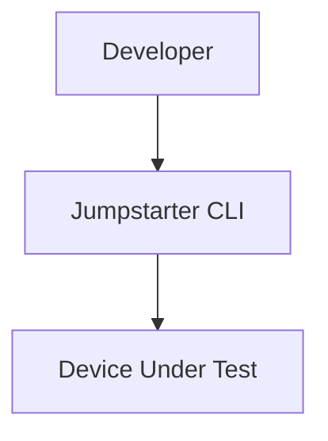
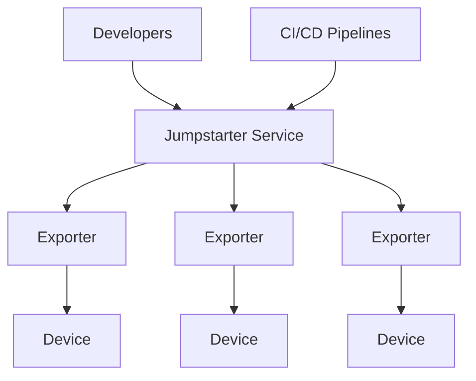

<div class="absolute inset-0 bg-[#f0f0f0]" />

<!-- Partner logos top-right -->
<div class="absolute top-6 right-8 flex items-center gap-5 z-10">
  
  <div class="w-px h-14 bg-gray-400" />
  
</div>

<!-- Jumpstarter logo left-aligned -->
<div class="absolute top-[26%] left-14 z-10">
  
</div>

<!-- Yellow band at the bottom -->
<div class="absolute bottom-0 left-0 right-0 h-[42%] bg-[#ffc107] z-10">
  <div class="px-14 pt-6">
    <p class="text-[2.2rem] font-semibold text-black leading-tight tracking-tight" style="font-family: sans-serif;">Cloud Native Hardware-in-the-Loop Testing</p>
  </div>
</div>

---
layout: center
class: text-center
---

# Testing Embedded Software is Hard...

<div class="text-8xl mt-12">

🤯

</div>

---
layout: default
---

# Key Challenges of Embedded Testing

<div class="grid grid-cols-2 gap-6 mt-8">

<div class="flex gap-3 items-start">
  <span class="text-3xl">🤯</span>
  <div>
    <h3 class="text-lg font-bold">Difficult to maintain</h3>
    <p class="text-sm opacity-75">Hardware is scattered across desks, different labs, and different facilities.</p>
  </div>
</div>

<div class="flex gap-3 items-start">
  <span class="text-3xl">🤖</span>
  <div>
    <h3 class="text-lg font-bold">Hardware is scarce</h3>
    <p class="text-sm opacity-75">Sometimes development boards are hard to come by or very expensive to procure.</p>
  </div>
</div>

<div class="flex gap-3 items-start">
  <span class="text-3xl">💔</span>
  <div>
    <h3 class="text-lg font-bold">Fragmented setups</h3>
    <p class="text-sm opacity-75">Developers have one setup, CI systems have another, no consistency between the two.</p>
  </div>
</div>

<div class="flex gap-3 items-start">
  <span class="text-3xl">👦</span>
  <div>
    <h3 class="text-lg font-bold">Low utilization</h3>
    <p class="text-sm opacity-75">Hardware is often tied to a specific developer or team making it hard to utilize all available hardware effectively.</p>
  </div>
</div>

<div class="flex gap-3 items-start">
  <span class="text-3xl">🔌</span>
  <div>
    <h3 class="text-lg font-bold">Heterogeneous interfaces</h3>
    <p class="text-sm opacity-75">Embedded hardware interfaces vary, making it difficult to interact with them remotely.</p>
  </div>
</div>

<div class="flex gap-3 items-start">
  <span class="text-3xl">📈</span>
  <div>
    <h3 class="text-lg font-bold">Hard to scale</h3>
    <p class="text-sm opacity-75">It can be difficult to scale automated hardware testing setups due to the previous issues.</p>
  </div>
</div>

</div>

---
layout: center
---

# This is a Solved Problem in Software

<div class="grid grid-cols-2 gap-8 mt-8">

<div>

<v-clicks>

- CI/CD Pipelines are ubiquitous
- DevOps is now standardized
- Testing is an expectation
- Shift-left in testing, security, etc.

</v-clicks>

</div>

<div class="flex items-center justify-center">
  
</div>

</div>

---
layout: two-cols
layoutClass: gap-8
---

# What is Hardware-in-the-Loop?

Hardware-in-the-Loop (HiL) is a testing method where physical hardware components interact with a simulated environment to validate embedded systems under realistic operating conditions.

<div class="mt-6">

**HiL testing is common in industries such as:**

- 🚘 Automotive
- 🤖 Robotics
- 🚀 Aerospace

</div>

::right::

<div class="flex items-center justify-center h-full">
  
</div>

---
layout: default
---

# Challenges in the HiL Landscape

<div class="grid grid-cols-2 gap-x-12 gap-y-4 mt-6 text-sm">

<div class="border-l-3 border-red-400 pl-4">
  <h3 class="font-bold text-red-400">Proprietary Toolchains</h3>
  <p class="opacity-75">Closed-source, expensive platforms limit developer access.</p>
</div>

<div class="border-l-3 border-green-400 pl-4">
  <h3 class="font-bold text-green-400">Open Tooling</h3>
  <p class="opacity-75">Open source software to reduce cost and vendor lock-in.</p>
</div>

<div class="border-l-3 border-red-400 pl-4">
  <h3 class="font-bold text-red-400">Cost vs. Criticality Gap</h3>
  <p class="opacity-75">Testing tools priced for safety-critical systems are often overkill for infotainment or IoT devices.</p>
</div>

<div class="border-l-3 border-green-400 pl-4">
  <h3 class="font-bold text-green-400">Scalable Criticality</h3>
  <p class="opacity-75">Provide support for different criticalities through integrations with existing tools.</p>
</div>

<div class="border-l-3 border-red-400 pl-4">
  <h3 class="font-bold text-red-400">Hardware Access</h3>
  <p class="opacity-75">Shared labs, local devices, and virtual devices often have inconsistent access methods.</p>
</div>

<div class="border-l-3 border-green-400 pl-4">
  <h3 class="font-bold text-green-400">Isomorphic Interfaces</h3>
  <p class="opacity-75">Provide a unified hardware access interface for local, remote, and virtual hardware.</p>
</div>

<div class="border-l-3 border-red-400 pl-4">
  <h3 class="font-bold text-red-400">CI/CD Misalignment</h3>
  <p class="opacity-75">Most hardware testing tools don't integrate cleanly into modern DevOps workflows.</p>
</div>

<div class="border-l-3 border-green-400 pl-4">
  <h3 class="font-bold text-green-400">Declarative Configs</h3>
  <p class="opacity-75">Use existing DevOps technologies such as OIDC, RBAC, and GitOps.</p>
</div>

</div>

---
layout: center
class: text-center
---


# Introducing Jumpstarter

---
layout: default
---

# What is Jumpstarter?

<div class="mt-4 text-lg opacity-80">
Jumpstarter is a cloud native Hardware-in-the-Loop testing framework for building secure and scalable testing solutions for embedded devices.
</div>

<div class="mt-8">

**Jumpstarter does three things:**

<v-clicks>

1. **Provides a secure framework** for abstracting hardware interfaces.
2. **Enables on-demand hardware access** for developers and automated systems.
3. **Manages test benches** using cloud native tools such as Kubernetes and GitOps.

</v-clicks>

</div>

---
layout: default
---

# How Does It Work?

<div class="grid grid-cols-3 gap-8 mt-12">

<div class="text-center p-6 rounded-xl bg-blue-500/10 border border-blue-500/20">
  <div class="text-4xl mb-4">🐍</div>
  <h3 class="font-bold text-blue-400 text-lg">Python Framework</h3>
  <div class="mt-3 text-sm opacity-75">
    <p>Hardware Abstraction</p>
    <p>Test Automation</p>
  </div>
</div>

<div class="text-center p-6 rounded-xl bg-green-500/10 border border-green-500/20">
  <div class="text-4xl mb-4">⌨️</div>
  <h3 class="font-bold text-green-400 text-lg">Command-Line Tool</h3>
  <div class="mt-3 text-sm opacity-75">
    <p>Local Development</p>
    <p>Interactive Debugging</p>
  </div>
</div>

<div class="text-center p-6 rounded-xl bg-purple-500/10 border border-purple-500/20">
  <div class="text-4xl mb-4">☸️</div>
  <h3 class="font-bold text-purple-400 text-lg">Kubernetes Controller</h3>
  <div class="mt-3 text-sm opacity-75">
    <p>Access Control & Coordination</p>
    <p>Seamless Remote Access</p>
  </div>
</div>

</div>

---
layout: default
---

# How Can I Use This?

<div class="grid grid-cols-2 gap-12 mt-8">

<div>
  <h3 class="text-xl font-bold mb-4 text-blue-400">Local</h3>



</div>

<div>
  <h3 class="text-xl font-bold mb-4 text-green-400">Distributed</h3>



</div>

</div>

---
layout: default
---

# Example Use Cases

<div class="grid grid-cols-4 gap-4 mt-8 text-center text-sm">

<div class="p-4 rounded-lg bg-blue-500/10 border border-blue-500/20">
  <h3 class="font-bold mb-2">Local Dev</h3>
  <p class="opacity-70">Developer + CLI + QEMU</p>
</div>

<div class="p-4 rounded-lg bg-green-500/10 border border-green-500/20">
  <h3 class="font-bold mb-2">Remote Dev</h3>
  <p class="opacity-70">Developer + Service + Exporter + DUT</p>
</div>

<div class="p-4 rounded-lg bg-purple-500/10 border border-purple-500/20">
  <h3 class="font-bold mb-2">Remote CI</h3>
  <p class="opacity-70">CI Pipeline + Service + Exporter + DUT</p>
</div>

<div class="p-4 rounded-lg bg-amber-500/10 border border-amber-500/20">
  <h3 class="font-bold mb-2">Local CI</h3>
  <p class="opacity-70">CI Pipeline + Runner + DUT</p>
</div>

</div>

<div class="flex justify-center gap-6 mt-8">
  
  
  
</div>

---
layout: default
---

# Architecture

<div class="flex justify-center mt-4">
  
</div>

<div class="grid grid-cols-4 gap-4 mt-6 text-xs">

<div class="text-center">
  <span class="font-bold text-blue-400">Drivers</span><br/>
  Python packages that "export" interfaces
</div>

<div class="text-center">
  <span class="font-bold text-green-400">Clients</span><br/>
  Python packages that "consume" exported interfaces
</div>

<div class="text-center">
  <span class="font-bold text-purple-400">Exporters</span><br/>
  Processes that "export" hardware using drivers
</div>

<div class="text-center">
  <span class="font-bold text-amber-400">Leases</span><br/>
  Manage lifecycle by "leasing" exporters to clients
</div>

</div>

---
layout: default
---

# Types of Driver Calls

<div class="flex justify-center mt-8">
  
</div>

<div class="grid grid-cols-3 gap-6 mt-6 text-sm text-center">

<div>
  <span class="font-bold text-green-400">Unary RPC</span><br/>
  <span class="opacity-70">Driver Call: desired state → result</span>
</div>

<div>
  <span class="font-bold text-blue-400">Server Streaming RPC</span><br/>
  <span class="opacity-70">Streaming Driver Call: interval → result stream</span>
</div>

<div>
  <span class="font-bold text-red-400">Bidirectional Streaming RPC</span><br/>
  <span class="opacity-70">Driver Stream: byte stream</span>
</div>

</div>

---
layout: default
---

# What Are the Benefits?

<div class="grid grid-cols-2 gap-8 mt-8">

<div class="p-5 rounded-xl bg-blue-500/10 border border-blue-500/20">
  <h3 class="font-bold text-lg mb-2">Support for more systems</h3>
  <p class="text-sm opacity-75">We support many boards and interfaces and are open to community contributions. Build proprietary drivers using the Jumpstarter Python framework.</p>
</div>

<div class="p-5 rounded-xl bg-green-500/10 border border-green-500/20">
  <h3 class="font-bold text-lg mb-2">Remote access without SSH</h3>
  <p class="text-sm opacity-75">Users can access remote hardware using secure gRPC tunnels instead of SSH.</p>
</div>

<div class="p-5 rounded-xl bg-purple-500/10 border border-purple-500/20">
  <h3 class="font-bold text-lg mb-2">Integration with CI tools</h3>
  <p class="text-sm opacity-75">Write tests in Python or shell scripts. Works with many existing CI systems without requiring local runners.</p>
</div>

<div class="p-5 rounded-xl bg-amber-500/10 border border-amber-500/20">
  <h3 class="font-bold text-lg mb-2">GitOps for hardware management</h3>
  <p class="text-sm opacity-75">You can use existing tools such as ArgoCD and flightctl for device management.</p>
</div>

</div>

---
layout: center
class: text-center
---

# Demo

<div class="text-6xl mt-8 animate-pulse">

⚡

</div>

---
layout: default
---

# Jumpstarter Shell

<div class="grid grid-cols-[1fr,1fr] gap-6">

<div>

```bash
$ jmp shell -l board=rcar-s4

⚡remote ➤ echo $JUMPSTARTER_HOST
/tmp/jumpstarter-nertk0nz/socket

⚡remote ➤ j
Usage: j [OPTIONS] COMMAND [ARGS]...
Composite exporter interface
Commands:
  storage   Flash the remote target eMMC
  power     Generic power interface
  serial    Serial port client

⚡remote ➤ j storage flash rcar4/target.gz
⚡remote ➤ j power on
⚡remote ➤ j serial start-console
⚡remote ➤ exit
```

</div>

<div class="text-sm mt-4 space-y-4">

<v-clicks>

- We use **label selectors** like Kubernetes to locate hardware.
- Jumpstarter creates a **local socket** to connect between the CLI and the Jumpstarter client.
- We can execute `j` commands to **interact with the hardware**.
- This is a **local shell** -- not SSH!

</v-clicks>

</div>

</div>

---
layout: default
---

# Python Tests

```python
#!/bin/env python
import time
from jumpstarter.common.utils import env

with env() as client:
    client.storage.flash("image.img")
    client.power.on()
    while True:
        img = client.video.snapshot()
        img.save("video.jpg")
        time.sleep(0.2)
```

<div class="mt-4 opacity-70 text-sm">

Run with: `jmp shell -l board=rcar-s4 -- python example.py`

</div>

---
layout: default
---

# Pytest Example

```python
from jumpstarter.testing.pytest import JumpstarterTest
from jumpstarter_imagehash import ImageHash

class TestExample(JumpstarterTest):
    def test_boot_login(self, client):
        with client.serial.pexpect() as console:
            client.power.cycle()
            console.expect("login:", timeout=240)
            console.sendline("user")
            console.expect("Password:", timeout=30)
            console.sendline("password")

    def test_boot_image(self, client):
        hasher = ImageHash(client.video)
        hasher.assert_snapshot("expected.jpg")

    def test_devices_in_place(self, client):
        with client.serial.pexpect() as console:
            console.sendline("ls /dev/nv*")
            console.expect("/dev/nvhost-gpu")
```

---
layout: two-cols
layoutClass: gap-6
---

# Exporter Config

```yaml
apiVersion: jumpstarter.dev/v1alpha1
kind: ExporterConfig
metadata:
  name: exporter1
  namespace: jumpstarter-lab
endpoint: grpc.devel.jumpstarter.dev:443
token: ********************
export:
  storage:
    type: jumpstarter_driver_sdwire
          .driver.SDWire
    config:
      storage_device: "/dev/disk/..."
      serial: "e605c805"
  power:
    type: jumpstarter_driver_snmp
          .driver.SNMPServer
    config:
      server: my.snmp.server
      plug: 13
```

::right::

<div class="mt-12 text-sm space-y-4">

<v-clicks>

- **Versioned config API** for future improvements and backwards compatibility
- **Name and namespace** of the exporter, just local metadata
- **Endpoint** of Jumpstarter gRPC service and API token
- **SD Wire** storage multiplexer allows us to "swap" a SD card between the DUT and host
- **SNMP** networked power supply
- **PySerial** driver to connect to DUTLink test harness
- **UStreamer** driver to provide "live" video of DUT

</v-clicks>

</div>

---
layout: center
class: text-center
---

# Jumpstarter Community

<div class="flex gap-16 items-center justify-center mt-12">

<div class="text-center">
  <div class="text-5xl mb-3">🌐</div>
  <a href="https://jumpstarter.dev" class="text-blue-400 font-bold">jumpstarter.dev</a>
</div>

<div class="text-center">
  <div class="text-5xl mb-3"><carbon:logo-github /></div>
  <a href="https://github.com/jumpstarter-dev" class="text-blue-400 font-bold">github.com/jumpstarter-dev</a>
</div>

<div class="text-center">
  <div class="text-5xl mb-3">💬</div>
  <span class="text-blue-400 font-bold">Matrix Chat</span>
</div>

</div>

---
layout: center
class: text-center
---

# Thank You!


<div class="mt-8 text-lg opacity-60">

[jumpstarter.dev](https://jumpstarter.dev) | [github.com/jumpstarter-dev](https://github.com/jumpstarter-dev)

</div>
